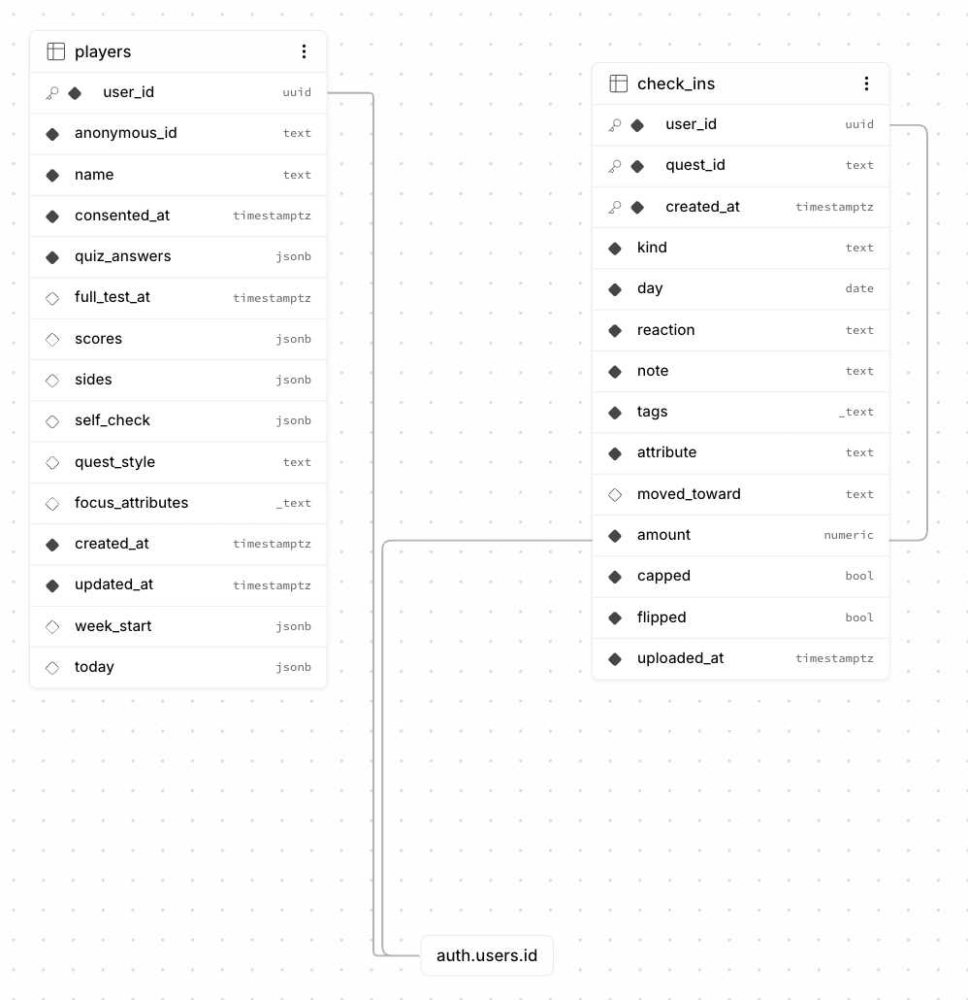
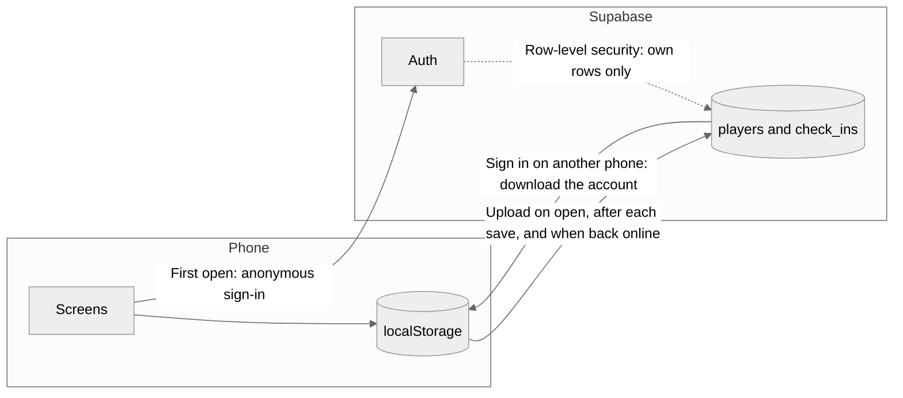

# Me Online

Me Online is a mobile web app that turns everyday life into a role-playing game, so players can find out what they actually like by trying things for themselves. Each day it gives three small real-world quests. The player tries one, then checks in with Liked, Okay, or Disliked. Each check-in nudges one of five Big Five attributes on their character, and over time a Preference Map shows which kinds of quests give them energy and which drain them.

It is built for undergraduates in mainland China who have mostly followed paths set by school and parents, and who have had little chance to test what they enjoy. The attributes are game values, not a personality assessment.

**Live app:** https://me-online-three.vercel.app/

## Sprint 1 features

- **Onboarding.** Welcome, consent, display name, and the 15-item BFI-2-XS quiz in Chinese.
- **Character.** Five attributes from 0 to 100, a self-check, and a choice of Comfort or Explore quest style with one or two focus attributes.
- **Full test.** The optional 60-item BFI-2, which rescores the attributes and keeps the change from earlier check-ins.
- **Today board.** Three quests a day that refresh at 4:00 a.m. China time, with one swap a day and no repeats within a week.
- **Check-ins.** Liked, Okay, or Disliked, with an optional note and up to three tags. A result card shows how the attribute moved, with a weekly limit of ±1 point.
- **Preference Map.** Unlocks after 5 check-ins and shows energizers, drainers, and a reaction table.
- **History.** Past check-ins, newest first, each with a read-only detail page.
- **Edit quest style.** Change the quest style and focus attributes from the Character screen.
- **Accounts.** Every phone starts as an anonymous player. Email sign-up keeps the data saved so far, and signing in on another phone restores it.
- **Cloud backup.** Data is saved on the phone first and uploaded to Supabase. Failed uploads retry quietly.

## Documentation

| Document | What it covers |
| --- | --- |
| [PRD](docs/prd.md) | Goals, scope, and the functional and non-functional requirements |
| [User flows](docs/user-flows.md) | First-time player, daily play, and reflection, with flow diagrams |
| [Data model](docs/data-model.md) | Every table column and localStorage key, and who can see what |
| [Wireframes](docs/wireframes/sprint1) | One image per Sprint 1 screen |

## Database schema



- `auth.users` is managed by Supabase. Each phone gets a user the first time the app opens.
- `players` has one row per player: name, consent time, quiz answers, scores, quest style, and today's quests.
- `check_ins` has one row per check-in. Rows are never changed after they are saved.
- Row-level security lets each player read and write only their own rows. Nobody can delete through the app.

The tables are created by the SQL files in [backend/supabase/migrations](backend/supabase/migrations), run in order. The full column list is in the [data model](docs/data-model.md).

## Data flow



1. Every change is saved to localStorage first, so the app works without a connection.
2. The app then uploads a copy to Supabase. If the upload fails, the data stays on the phone and the next upload tries again.
3. Signing up adds an email and password to the anonymous user, so the uploaded rows stay with the account.
4. Signing in on another phone downloads the account's data and writes it to that phone.

## Project structure

```
Me-online/
├── backend/
│   └── supabase/
│       └── migrations/   SQL that creates the tables, run in order
├── data/
│   └── quests.json       The 60 quests, in Chinese and English
├── docs/                 PRD, user flows, data model, wireframes
└── frontend/             Web app (React + TypeScript + Vite)
    └── src/
        ├── game/         Game rules as pure functions, with unit tests
        ├── storage/      Saving data on the phone (localStorage)
        ├── remote/       Supabase: sign-in, upload, restore
        ├── components/   Pieces shared by several screens
        ├── screens/      One folder per tab or flow
        │   ├── onboarding/   Welcome, consent, quiz, character setup
        │   ├── today/        Today's quests, detail, check-in, result card
        │   ├── character/    Character tab and full 60-item test
        │   ├── map/          Preference Map
        │   ├── history/      History and history detail
        │   └── account/      Sign in and sign up
        ├── styles/       One stylesheet per feature, plus shared ones
        └── text/         All interface text, in Chinese and English
```

## Deployment and tech stack

- **Frontend:** React 18, TypeScript, and Vite, tested with Vitest. Icons from lucide-react.
- **Backend:** Supabase (Postgres, Auth, and row-level security).
- **Hosting:** Vercel deploys `main` automatically, with `frontend` as the root directory. It needs two environment variables, `VITE_SUPABASE_URL` and `VITE_SUPABASE_PUBLISHABLE_KEY`.
