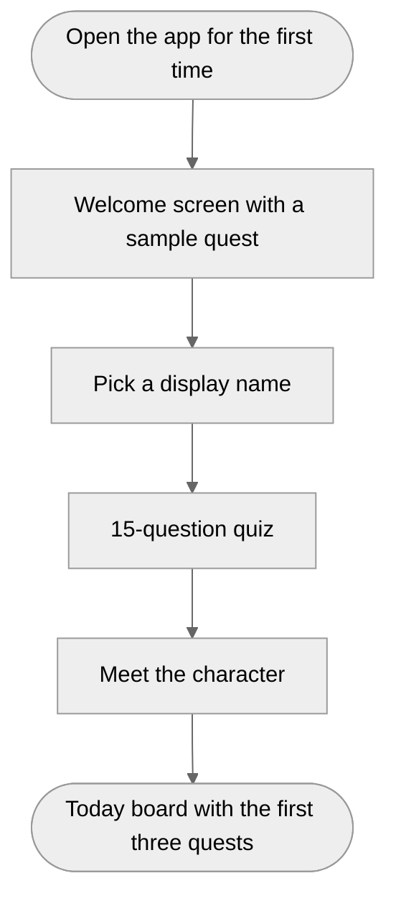
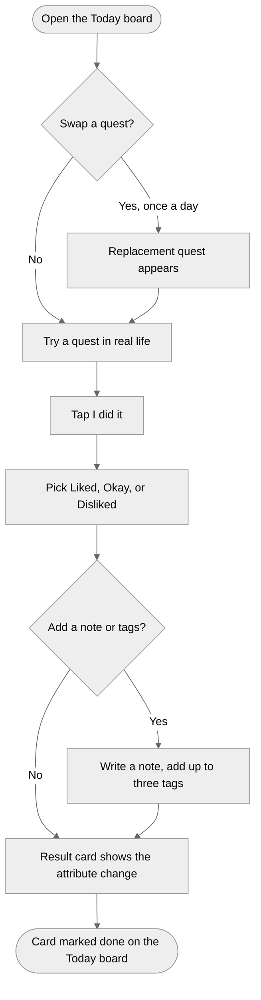
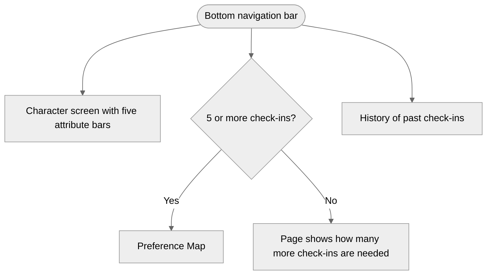

# Me Online User Flows (Sprint 1)

## The daily loop

The player opens the app and sees three quests. They can swap one, pick one to do in real life, and come back to check in. Each check-in moves an attribute a little. The player can also add a short tag of their own to say what exactly they liked or disliked, such as “prefer groups of four or fewer” after a party quest. Over time the Preference Map shows the patterns.

## Navigation

The app opens on the Today board. A bottom navigation bar links the four pages, Today, Character, Preference Map, and History.

## Flow 1, first-time player

- The player lands on a welcome screen that explains the idea in two sentences and shows a sample quest.
- They pick a display name.
- They take the 15-question quiz, one question per screen with a progress bar.
- They meet their new character with five attributes and a short note that these are starting game values, not a personality assessment.
- They land on the Today board with their first three quests.

## Flow 2, daily play

- The player opens the Today board and sees three quest cards. Each card shows whether it is a home or stretch quest, the attribute, and an estimated time.
- They can swap one card per day.
- After trying a quest, they tap “I did it.”
- They pick Liked, Okay, or Disliked and can write a short note about how it went.
- They can add tags of their own to make the reaction more specific, such as “prefer groups of four or fewer.”
- A short result card shows how the attribute moved.
- Back on the Today board, the finished card is marked done. The player can check in on more quests that day.

## Flow 3, reflection

- The player opens the Character screen to see their five attribute bars.
- Once there are enough check-ins, they open the Preference Map to see which kinds of quests they liked or disliked, along with the tags they added.
- They open history to reread past check-ins, notes, and tags.
